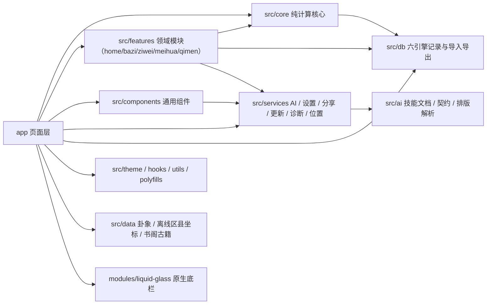

# 见机 Jianji 架构文档

见机是一款基于 Expo + React Native 构建的跨平台易学排盘与典籍学习应用，当前围绕六爻、梅花易数、奇门遁甲、八字命理、八字合盘、紫微斗数六条排盘链路，以及「书阁」速查与古籍阅读模块，提供输入、计算、展示、存储、备份恢复、检查更新与多协议 AI 辅助分析能力。

产品预览见 [README.md](./README.md)。

## 1. 项目概览

项目当前包含六条核心排盘/分析业务链路与一个学习模块：

- 六爻排盘（`liuyao`）
- 梅花易数（`meihua`）
- 奇门遁甲（`qimen`）
- 八字命理（`bazi`）
- 八字合盘（`baziCompatibility`）
- 紫微斗数（`ziwei`）
- 书阁（速查表与 41 部离线古籍阅读）

统一能力覆盖：

- 输入与排盘
- 结果展示与历史回看
- 收藏、搜索与按引擎筛选
- 备份导出与恢复导入（`version: 4`）
- 多协议 AI 后台分析、分章节流式展示、快捷追问与会话导出
- 检查更新与脱敏故障日志导出

## 2. 技术基线

### 2.1 主要栈

- Expo SDK 58（应用版本 `1.8.3`）
- React Native 0.88.1
- React 19.3.0
- TypeScript 7.0.2
- Expo Router
- `expo-sqlite`
- `@react-native-async-storage/async-storage`
- `tyme4ts@1.5.6`
- `iztro@2.6.5`
- 内置全国离线行政区经纬度数据集 `src/data/china-regions.json`（源自 `xiangyuecn/AreaCity-JsSpider-StatsGov 2025.251231.260403`，MIT）
- `react-native-reanimated@4.7.1`、`react-native-worklets@0.13.0`、`react-native-gesture-handler`
- `react-native-sse`
- `react-native-svg`
- `@formatjs/intl-pluralrules`
- `expo-clipboard`、`expo-document-picker`、`expo-file-system`、`expo-sharing`、`expo-font`
- 本地原生模块 `modules/liquid-glass`（供底部导航栏 `LiquidTabBar` 使用）

### 2.2 运行配置

- 入口：`package.json -> expo-router/entry`
- 应用名：`见机`
- `slug`：`jianji`
- 包名 / Scheme：`com.jianji.app` / `jianji`
- 开发版变体：`app.config.js` 在 `APP_VARIANT=development` 时自动切换为 `见机开发版`、`jianji-dev` 与 `com.jianji.app.dev`，便于开发构建与正式版同机并存
- `metro.config.js`：
  - 注册 `wasm` 资源扩展，供 Web 端 SQLite 兼容使用
  - 注册 `.book` 资源扩展，书阁古籍正文按资源打包并在打开时按需读取
  - 注册 `.md` 源码扩展并通过 `scripts/markdown-transformer.cjs` 编译 AI 技能文档
  - 挂载本地开发期 Web AI 代理中间件 `/__jianji_ai_proxy`（仅放行 `/responses`、`/messages`、`/interactions`、`/models`）
- `eas.json` 包含 `development / preview / production` 三套 profile；Android 正式版与 beta 包由 GitHub Actions 直编签名发布
- `app/_layout.tsx` 在根布局最先加载 `src/polyfills/intl.ts`

补充说明：

- 视觉主题由 `src/theme/ThemeContext.tsx` 控制，仅保留两套主题：
  - `yin`：太阴玄黑（`src/theme/colors.ts`）
  - `yang`：太阳宣白（`src/theme/colors-white.ts`）；历史 `'white'` 配置会自动归一化为 `'yang'`
- 全局底景由 `src/components/PageBackground.tsx`（含 `YunZhuanBanners` 与 `assets/fonts/JianJiYunZhuan.ttf` 子集字体）通过根 `Stack` 的 `screenLayout={withPageBackground}` 统一承载；各页面保持透明背景（由 `scripts/check-page-background.cjs` 检查）
- 仓库内部仍沿用部分历史命名：
  - npm 包名：`liuyao-app`
  - 原生数据库文件：`liuyao.db`

## 3. 启动与页面结构

### 3.1 启动链路

1. `expo-router/entry`
2. `app/_layout.tsx`
3. `app/(tabs)/_layout.tsx`

根布局负责：

- 注入 `Intl.PluralRules` polyfill
- 控制 Splash Screen 生命周期并挂载开屏过渡 `LaunchOverlay`
- 注入 `ThemeProvider`、`GanZhiRelationSettingsProvider`、`GestureHandlerRootView`、`SafeAreaProvider`、`NavigationThemeProvider` 与全局弹窗 `CustomAlertProvider`
- 挂载根级 `Stack`（通过 `screenLayout={withPageBackground}` 注入公共水墨背景）

底栏布局（`app/(tabs)/_layout.tsx`）通过 `LiquidTabBar` 与本地模块 `modules/liquid-glass` 的 `GlassTarget` 承载首页、书阁、历史、设置四个标签页。

### 3.2 主路由与书阁路由

| 路由 | 页面 | 说明 |
| --- | --- | --- |
| `/` | `app/(tabs)/index.tsx` | 首页，提供六爻、梅花易数、奇门遁甲、八字命理（含合盘）、紫微斗数五大术数卡片 |
| `/learn` | `app/(tabs)/learn.tsx` | 书阁首页：5 项速查入口 + 山医命相卜五卷 41 部古籍书目与搜索 |
| `/history` | `app/(tabs)/history.tsx` | 六引擎统一历史记录、收藏筛选、关键词搜索与分舱过滤 |
| `/settings` | `app/(tabs)/settings.tsx` | 主题切换、多接口 AI 中枢、备份/恢复、检查更新与故障日志导出 |
| `/learn/hexagrams` | `app/learn/hexagrams.tsx` | 六十四卦速查列表 |
| `/learn/hexagram/[id]` | `app/learn/hexagram/[id].tsx` | 单卦详情页（卦象、卦辞、爻辞） |
| `/learn/ref/[key]` | `app/learn/ref/[key].tsx` | 速查页：`trigram`（八卦类象）、`nayin`（纳音）、`shensha`（神煞）、`tiyong`（体用诀） |
| `/learn/reader` | `app/learn/reader.tsx` | 古籍正文阅读器（宋体排版、三档字号、目录抽屉、章节切换与阅读进度记录） |

### 3.3 六爻链路

| 路由 | 页面 | 说明 |
| --- | --- | --- |
| `/divination/coin` | `app/divination/coin.tsx` | 硬币起卦 |
| `/divination/manual` | `app/divination/manual.tsx` | 手动起卦 |
| `/result/[id]` | `app/result/[id].tsx` | 六爻结果页（「卦盘」「细批」双视图、互错综抽屉、AI 解卦、Markdown 导出） |

旧版时间起卦与数字起卦入口已迁入梅花易数链路，历史保存的 `time` / `number` 六爻记录仍可正常打开与导入。

### 3.4 梅花易数链路

| 路由 | 页面 | 说明 |
| --- | --- | --- |
| `/meihua/input` | `app/meihua/input.tsx` | 梅花起卦输入页（支持 `?mode=time` 时间起卦与 `?mode=number` 数字起卦、实时推演预览） |
| `/meihua/result/[id]` | `app/meihua/result/[id].tsx` | 梅花结果页（「卦象」「断语」双视图、AI 解卦、Markdown 导出） |

### 3.5 奇门遁甲链路

| 路由 | 页面 | 说明 |
| --- | --- | --- |
| `/qimen/input` | `app/qimen/input.tsx` | 奇门起盘页（转盘/飞盘/星飞门转、拆补/置闰/茅山、时间/报数起局、沿用此盘再起预填） |
| `/qimen/result/[id]` | `app/qimen/result/[id].tsx` | 奇门结果页（「九宫」「信息」「复盘」三视图、年/月/日/时四盘切换、时辰步进预览与另存、双击宫位放大卡、四盘对照、AI 四盘合读与单盘 Markdown 导出） |

### 3.6 八字与合盘链路

| 路由 | 页面 | 说明 |
| --- | --- | --- |
| `/bazi/input` | `app/bazi/input.tsx` | 八字输入页，支持新建与修改（公历/农历/四柱反查、三种时间口径、夏令时、子时口径、参考时点） |
| `/bazi/result/[id]` | `app/bazi/result/[id].tsx` | 八字结果页 |
| `/bazi/ganzhi/[id]` | `app/bazi/ganzhi/[id].tsx` | 干支关系详解页与关系图示 |
| `/bazi/ganzhi/settings` | `app/bazi/ganzhi/settings.tsx` | 干支作用规则设置页 |
| `/bazi/match` | `app/bazi/match/index.tsx` | 八字合盘选择页（任选两条八字记录、6 种关系与方向、双盘弧线初看） |
| `/bazi/match/result/[id]` | `app/bazi/match/result/[id].tsx` | 八字合盘结果页（总览/详断、双盘弧线、互看十神、五行蝶形对比、典籍依据抽屉、婚期/顺年、AI 合盘详批） |

八字结果页包含两大视图（并支持隐私模式遮罩与 Markdown 导出）：

- 命盘概览
- 专业细盘

专业细盘支持两种面板切换与底部浮岛运程坞（`FortuneDock`）：

- `fortune`：大运（或小运）、流年、流月、流日、流时五层联动
- `taiming`：胎元、命宫、身宫延展视图

### 3.7 紫微斗数链路

| 路由 | 页面 | 说明 |
| --- | --- | --- |
| `/ziwei/input` | `app/ziwei/input.tsx` | 紫微输入页，支持新建与修改 |
| `/ziwei/result` | `app/ziwei/result.tsx` | 紫微即时结果页，按会话缓存或路由参数构建/渲染命盘 |
| `/ziwei/result/[id]` | `app/ziwei/result/[id].tsx` | 紫微历史记录加载器，读取存档后跳转结果页 |

紫微结果页当前由以下结构组成：

- 主画布：十二宫棋盘（`ZiweiBoardView`）与运限时间轴（`ZiweiTimeAxis`），支持在宽屏下以右侧栏常驻展示详盘，窄屏下以底部预览条（`ZiweiPeekBar`）和抽屉（`ZiweiSheet`）查看当前宫位详情（`ZiweiPalaceDetail`，含三方四正、宫干飞化、十二神）
- 双击宫位弹出居中放大卡（`ZiweiZoomCard`）
- 顶部栏提供命盘信息面板（`ZiweiInfoPanel`）、盘面规则配置面板（`ZiweiConfigPanel`，可即时改派并重排）与 AI 分析入口

运限时间轴视图（`ZIWEI_VIEWS`）支持 6 层切换：

- `natal`：本命
- `decadal`：大限
- `yearly`：流年
- `monthly`：流月
- `daily`：流日
- `hourly`：流时

## 4. 分层设计

项目可以按 10 层理解：

1. 页面层：`app/`
2. 组件层：`src/components/`
3. 纯计算核心层：`src/core/`
4. 业务领域模块层：`src/features/{home,bazi,ziwei,meihua,qimen}/`
5. AI 技能与排版层：`src/ai/`
6. 数据持久化层：`src/db/`
7. 服务层：`src/services/`
8. 主题 / Hook / 工具 / Polyfill 层：`src/theme/`、`src/hooks/`、`src/utils/`、`src/polyfills/`
9. 静态数据与典籍层：`src/data/`（含 `china-regions.json` 与 `classics/`）
10. 本地原生模块层：`modules/liquid-glass/`



## 5. 核心数据模型

### 5.1 六爻结果：`PanResult`

定义位置：`src/core/liuyao-calc.ts`

主要字段：

- 标识：`id`、`createdAt`
- 来源：`method`、`subject`（`male` / `female` / `other`）、`question`
- 时间：`solarDate`、`solarTime`、`trueSolarTime`
- 地点：`location`、`longitude`
- 历法：`lunarInfo`、`jieqi`
- 四柱：`yearGanZhi`、`monthGanZhi`、`dayGanZhi`、`hourGanZhi`
- 排盘主体：`benGua`、`benGuaYao`、`bianGua`、`bianGuaYao`
- AI：`aiAnalysis`、`aiChatHistory`、`quickReplies`

### 5.2 梅花结果：`MeihuaResult`

定义位置：`src/features/meihua/types.ts`

主要字段：

- 标识与来源：`kind: 'meihua'`、`id`、`createdAt`、`method`（`meihua_time` / `meihua_number`）、`question`、`subject`、`recentEvents`、`timeRange`
- 历法与取数：`solarDate`、`solarTime`、`lunarInfo`、`jieqi`、`numbers`、`formulas`
- 卦象主体：`movingLine`、`ben`、`hu`、`bian`、`tiPosition`（`upper` / `lower`）
- AI：`aiAnalysis`、`aiChatHistory`、`quickReplies`

### 5.3 奇门结果：`QimenResult`

定义位置：`src/features/qimen/types.ts`

主要字段：

- 标识与规则：`kind: 'qimen'`、`id`、`createdAt`、`method: 'qimen_hour'`、`form`（`转盘` / `飞盘` / `星飞门转`）、`juMethod`、`spiritStyle`、`numberSeed`、`ruleVersion`、`boardVersion`、`sourceId`
- 时间与地点：`timeBasis: 'clock'`、`timezoneOffsetMinutes: -480`、`dayBoundary`、`centerRule`、`inputDateTime`、`solarDate`、`solarTime`、`location`、`longitude`、`lunarDate`、`fourPillars`、`solarTerm`、`yuan`、`fuTou`
- 盘面主体（继承 `QimenBoard`）：`dun`、`ju`、`xunHead`、`hiddenStem`、`voidBranches`、`horseBranch`、`horsePalace`、`chiefStar`、`chiefGate`、`chiefOrigin`、`chiefStarPalace`、`chiefGatePalace`、`chiefGateRawPalace`、`palaces`
- 复盘与 AI：`reviews`、`aiEvidence`、`aiAnalysis`、`aiChatHistory`、`quickReplies`

### 5.4 八字结果：`BaziResult`

定义位置：`src/core/bazi-types.ts`

主要字段：

- 标识：`id`、`createdAt`、`calculatedAt`
- 时间：`solarDate`、`solarTime`、`trueSolarTime`、`timeMeta`
- 输入语义：`gender`、`subject`、`longitude`、`schoolOptionsResolved`
- 本命结构：`fourPillars`、`shiShen`、`cangGan`、`pillarMatrix`、`baseInfo`、`jieQiContext`、`yuanMing`、`analysisProfile`
- 运势结构：`childLimit`、`currentDaYunIndex`、`daYun`、`liuNian`、`xiaoYun`
- 神煞结构：`shenSha`、`shenShaV2`
- AI 运行态：`aiAnalysis`、`aiChatHistory`、`quickReplies`、`aiConversationStage`、`aiVerificationSummary`、`aiVerificationMarks`、`aiConversationDigest`、`aiContextSnapshot`、`aiWorkflowVersion`、`aiWorkflowBirthSignature`、`aiKinshipVerification`

### 5.5 八字合盘结果：`BaziCompatibilityResult`

定义位置：`src/features/bazi/match/types.ts`

主要字段：

- 标识与双方命盘：`id`、`createdAt`、`calculatedAt`、`male`、`female`、`maleProfile`、`femaleProfile`
- 关系与视角：`relation`（`love` / `biz` / `friend` / `work` / `kin` / `sib`）、`direction`（`superior` / `peer` / `subordinate` / `parent` / `child`）、`self`（`male` / `female`）
- 评判与应期：`dimensions`、`totalScore`、`grade`、`summary`、`marriageYears`、`marriageTiming`、`review`、`evidenceMatrix`
- AI：`aiAnalysis`、`aiChatHistory`

### 5.6 紫微结果：`ZiweiRecordResult`

定义位置：`src/features/ziwei/record.ts`

主要字段：

- 标识：`id`、`createdAt`
- 输入语义：`birthLocal`、`longitude`、`gender`、`tzOffsetMinutes`、`daylightSavingEnabled`、`calendarType`、`lunar`、`config`、`cityLabel`、`name`
- 真太阳时派生：`solarDate`、`trueSolarDateTimeLocal`、`trueSolarLunar`、`timeIndex`、`timeLabel`、`timeRange`
- 命盘摘要：`lunarDate`、`chineseDate`、`fiveElementsClass`、`soul`、`body`
- AI 运行态：`aiAnalysis`、`aiChatHistory`、`quickReplies`、`aiConversationDigest`、`aiConversationStage`、`aiVerificationSummary`、`aiVerificationMarks`、`aiConfigSignature`、`aiInvalidatedAt`
- 规则与快照：`aiContextSnapshot`、`ruleSignature`、`chartSnapshot`

其中：

- `config` 描述当前门派与分界配置：算法、年界、运限界、晚子口径、天地人盘
- `ruleSignature` 绑定 prompt 种子版本、`iztro` 版本与亮度基线版本，用于判断历史记录是否仍匹配当前规则
- `chartSnapshot` 保存静态命盘快照，加快历史回看并支持与当前规则比对

### 5.7 统一记录 envelope

定义位置：`src/db/record-types.ts`

```ts
{
  engineType: 'liuyao' | 'bazi' | 'ziwei' | 'baziCompatibility' | 'meihua' | 'qimen',
  result: PanResult | BaziResult | ZiweiRecordResult | BaziCompatibilityResult | MeihuaResult | QimenResult,
  summary?: {
    method?: string;
    question?: string;
    title?: string;
    subtitle?: string;
  }
}
```

统一 envelope 负责：

- 历史记录列表摘要（含收藏标记、`castTime`、`qimenForm` 等展示信息）
- 备份导出与导入恢复
- Web / SQLite 双存储兼容
- 路由页根据 `engineType` 分发到对应结果页

## 6. 纯计算核心与视图模型

### 6.1 六爻核心

入口函数（`src/core/liuyao-calc.ts`）：`divinateByCoin()`、`divinateManual()`（并保留 `divinateByTime()`、`divinateByNumber()` 供核心兼容），最终统一进入 `calculatePan()`：

1. 根据地点经度决定是否进行真太阳时修正
2. 计算农历、节气、四柱、纳音
3. 生成本卦、变卦、动爻
4. 计算六神、六亲、世应、伏神与爻位旺衰状态（`liuyao-status.ts`）
5. 组装 `PanResult`

当前节气、月将、月相统一基于排盘使用的 `effectiveDate` 计算。

### 6.2 梅花核心

主要位于 `src/features/meihua/`：

- `engine.ts`：按农历年月日时或用户输入数字计算上卦、下卦、动爻及本/互/变三卦，并判定体用生克关系
- `rules.ts`、`images.ts`：计算月令卦气旺衰、规则断语与《说卦传》八卦类象

### 6.3 奇门核心

主要位于 `src/features/qimen/`（详细规则见 [src/features/qimen/README.md](./src/features/qimen/README.md)）：

- `engine.ts`、`flying-board.ts`、`period-board.ts`：直接基于 `tyme4ts` 的精确交节瞬间推算年/月/日/时四盘，实现转盘（拆补/置闰/茅山定局法与两套八神）、飞盘（《奇门鸣法》）与星飞门转（透派坐山）三种盘式
- `patterns.ts`、`rules.ts`：统一标注旬空、驿马、门宫生克、六仪击刑、古典三奇墓、伏吟/反吟、十干克应（81 组合格局）、五不遇时与转盘暗干
- `QimenComparison.tsx`、`QimenReview.tsx`、`ai-evidence.ts`、`palace-links.ts`：提供四盘对照、事后复盘、盘据快照校验与【盘·宫】回盘定位

### 6.4 八字与合盘核心

- 八字核心（`src/core/bazi-calc.ts`）：归一化输入、按本地钟表时 / 平太阳时 / 真太阳时换算时间、按子时口径选择 `EightCharProvider`、提取四柱/十神/藏干、计算起运与大运/流年/流月/小运、生成胎命身/人元司令/元命/神煞 v2（`bazi-shensha.ts`）、五行能量（`bazi-wuxing-energy.ts`）与干支关系引擎（`bazi-ganzhi-relation-engine.ts`、`bazi-ganzhi-diagram.ts`），结果页运行态通过 `src/features/bazi/view-model.ts` 与 `FortuneDock.tsx` 延展到流日与流时。
- 合盘核心（`src/features/bazi/match/`）：基于两条已有 `BaziResult` 计算 6 类关系维度、双盘干支作用弧线、互看十神、五行互补、婚期/顺年与典籍依据矩阵。

### 6.5 紫微核心与亮度基线

- 排盘与视图模型（`src/features/ziwei/iztro-adapter.ts`、`chart-engine.ts`、`scope-layer.ts`、`view-model.ts`）：
  1. 将输入页表单组装为 `ZiweiInputPayload`
  2. 基于出生地经度与 `UTC+8` 语义计算真太阳时，在公历 / 农历间互转并确定 `timeIndex`、`timeLabel`、`timeRange`
  3. 结合 `config` 调用 `iztro` 生成静态命盘，并由 `horoscope-fast.ts` 与 `scope-layer.ts` 将盘面拆分为「本命星曜层 / 运限层 / 选中层」以减少切运限重绘
  4. 写入 `ZiweiRecordResult`（含 `chartSnapshot` 与 `ruleSignature`），支持从历史记录快速恢复
- 亮度基线（`src/features/ziwei/brightness/`）：
  - 以 `ziwei-brightness-baseline.json`（`version: 2`）作为本地结构化主数据源，覆盖 `common_quanshu`、`zhongzhou`、`lingdonglai` 三套流派表（每套 59 星曜行、46 个完整 12 宫星曜、630 个有效宫位值）
  - 与 `iztro 2.6.5` 原始结果共同参与最终亮度标签解析，并通过 `ZIWEI_BRIGHTNESS_BASELINE_VERSION` 写入 `ruleSignature`

## 7. 存储、导出与兼容

### 7.1 存储策略

- 原生端：`expo-sqlite`（`liuyao.db`）
- Web 端：`localStorage`（`divination_records_v2`）

`src/db/database.ts` 两端统一暴露 `saveRecord / replaceRecord / updateExistingRecordResult / getRecord / getAllRecords / toggleFavorite / deleteRecord / exportAllRecords / importRecords` 等接口。

### 7.2 备份格式

备份当前版本为 `version: 4`（导出逻辑位于 `app/(tabs)/settings.tsx`，校验位于 `src/db/import-validation.ts`），支持：

- 六引擎记录混合导出
- 一并导出应用设置（`settings`）与干支关系规则设置（`ganZhiRelationSettings`）
- 导入前结构校验与冲突预览（`src/db/import-strategy.ts` 支持跳过重复或覆盖重复）
- 导出时自动清空 `apiKey`（并在 `meta.apiKeyIncluded: false` 中标注；导入旧备份中残留的 `geocoderApiKey` 会静默忽略）

### 7.3 兼容与辅助持久化策略

- Web 端自动迁移旧版 `liuyao_records` 到 `divination_records_v2`
- 原生 SQLite 会自动补齐 `engine_type`、`title`、`subtitle` 等迁移字段
- 旧六爻（含旧 `time` / `number` 起卦）、旧八字（`src/core/bazi-normalize.ts`）、旧合盘（无 `relation` / `self` 时按婚恋补齐）、旧奇门（无 `form` 时按时家转盘读取）记录均自动兼容
- 紫微导入记录校验 `tzOffsetMinutes === -480`（仅接受中国标准时区语义），并过滤非法 `aiChatHistory` 项
- 位置服务会把旧版城市结构归一化到新的 `RegionSelection`
- 书阁阅读进度持久化在 AsyncStorage 键 `learn_reading_v1`（`src/services/reading-progress.ts`）；诊断日志保存在 `diagnostic_logs_v1`（最多 200 条）

## 8. AI 与服务层

### 8.1 AI 工作流、技能体系与后台任务

核心实现：`src/services/ai.ts`、`src/services/ai-analysis-jobs.ts`、`src/ai/`、`src/components/AIChatModal.tsx`

- **模块化技能与输出契约**（`src/ai/`）：各术数提示词以 Markdown 文件存放在 `src/ai/skills/`，通过 `scripts/markdown-transformer.cjs` 打包，由 `skill-registry.ts` 与 `skill-composer.ts` 按引擎与阶段组装；`output-contracts.ts` 与 `src/ai/layout/`（`parse-chapter.ts`、`reflow.ts`）负责章节契约解析与排版；`AIChapterCard.tsx` 实现分章节流式淡入渲染。
- **上下文传递**：排盘资料与占问背景附在首条用户消息（`attachContext`），不混入系统提示词，兼顾中转网关兼容与前缀缓存。
- **后台任务管理**（`ai-analysis-jobs.ts`）：统一管理 `running / reasoning / streaming / validating / postprocessing / saving / completed / failed / interrupted / cancelled` 状态，支持切换页面后继续生成、草稿持久化、完整性校验与截断续写。
- **六引擎工作流**：
  - 六爻 / 梅花：单次解盘 + 连续追问
  - 奇门：四盘合读（总断 + 时/日/月/年四卷）+ 客户端盘据校验与【盘·宫】回盘链接 + 引用追问
  - 八字（v2）：基础定局 -> 可选六亲初验 / 实情反馈 -> 前事核验（支持逐条验证标记 `aiVerificationMarks`）-> 今年与未来五年 -> 专题追问
  - 紫微：基础命盘分析 -> 前事核验（支持逐条验证标记）-> 今年与未来五年 -> 专题追问
  - 八字合盘：单次合盘详批，支持重新生成与复制全文

### 8.2 设置与配置

`src/services/settings.ts` 保存版本化的设置文档（`settings_document_v2`）：多个接口（Base URL、API Key）及每个接口下的多个模型配置（协议、思考档位、输出上限等）。设置页改动后自动保存（防抖），无需手动点击保存；读取时静默忽略历史配置/备份中残留的 `geocoderApiKey`，并清理旧版 prompt / AI 解锁 / `settings_geocoder_api_key` 等历史存储键。

### 8.3 AI 接口与协议

- **支持 OpenAI Responses、Anthropic Messages 与 Gemini Interactions 三种协议**（`src/services/ai-provider-client.ts`、`ai-provider-types.ts`）。Chat Completions 在 `2ed7537` 中有意移除：旧实现没有思考控制，思考与正文共用 `max_tokens` 容易截断，长时间静默思考还会被网关以 524 断开，不再加回。
- **不按域名写死任何厂商地址。** Base URL 可能是官方接口，也可能是 new-api / sub2api 等中转或自建网关。端点、协议、参数只依据三件事：用户填写的地址、接口自身返回（模型目录元数据、报错内容）、实测结果。
- **地址规则**（`src/services/ai-endpoints.ts`）：路径为空补 `/v1/<端点>`（Gemini 补 `/v1beta/<端点>`）；以已知端点结尾则替换；末段是版本号（`v1`、`v4`、`v1beta`）直接接端点；其他路径当作 base 追加 `/v1/<端点>`（Gemini 为 `/v1beta/<端点>`）；末尾 `#` 表示原样请求。Gemini Interactions 使用 `x-goog-api-key` 并在请求体中设置 `store: false`。
- **协议探测**：`getProtocolCandidates` 按 URL 路径提示 -> 模型目录的端点类型 -> 模型名族排序，连接测试逐个尝试，成功后记录到模型配置（`protocolVerified`）。AI 中枢在地址、Key、模型齐全后会自动检测一次。
- **参数自愈**（`src/services/ai-compat-memory.ts`）：思考参数按协议标准格式发送，不再要求白名单。接口在未输出正文前以 4xx 拒收某个参数时，`streamProviderText` 去掉该参数重试一次，成功后按「接口配置 revision + 模型 + 协议」记住（Anthropic 侧 adaptive -> budget -> 不发；Responses 侧剔除不支持的 effort 或推理摘要；Gemini 侧剔除不支持的 `thinking_level`；温度；输出上限）。改地址或 Key 后记忆自动失效，「重新检测」会清空。
- **思考档位与输出余量**（`src/services/ai-model-capabilities.ts`）：AI 分析页右上角模型面板里的思考滑块按模型给出可选档位（`getThinkingStops`），始终思考 / 不支持的模型锁定。输出上限默认随档位自动计算（`resolveOutputBudget`），预算模式始终给正文保留余量；正文被截断或网关超时时，失败卡片提供「降一档重新生成」。
- **Responses 推理摘要**：开启思考时附带 `reasoning.summary: 'auto'`，让思考期间持续有事件推送，避免中转空闲断线；接口拒收时自动去掉。
- **Web 跨域代理**（`src/services/ai-web-proxy.ts` + `metro.config.js`）：Web 端遇到跨源接口时，本地开发自动走同源 `/__jianji_ai_proxy`，生产 Web 可通过环境变量 `EXPO_PUBLIC_AI_WEB_PROXY_URL` 指定代理地址，且不把 API Key 放进 URL。

### 8.4 地点、离线行政区与典籍阅读

- `src/services/location.ts`：保存用户已选出生地，兼容旧版城市结构归一化到 `RegionSelection`
- `src/core/city-data.ts` + `src/data/china-regions.json`：内置全国 34 省、392 市、3209 区县三级行政区与离线 WGS-84 经纬度（4 位小数，数据源自 `AreaCity-JsSpider-StatsGov 2025.251231.260403`），支持同步查表（`getRegionCoordinates`、`resolveRegionSelection`）、模糊检索、显示标签去重与旧区划码兼容，无需任何第三方联网地理编码 Key
- `src/data/classics/index.ts` 与 `src/services/reading-progress.ts`：管理书阁 41 部古籍书目（`index.json`）、按需读取 `.book` 正文（内存仅保留最近打开的一部）与阅读进度持久化

### 8.5 分享导出、更新检查与诊断日志

- `src/services/share.ts`：
  - 结果 Markdown 导出：支持六爻（`shareResultMarkdown`）、梅花（`shareMeihuaResultMarkdown`）、八字（`shareBaziResultMarkdown`）、奇门单盘（`shareQimenResultMarkdown`）
  - AI 会话 Markdown 导出：`shareChatMarkdown` 支持六爻、梅花、奇门、八字、紫微会话导出，并根据引擎生成差异化文件名与头部摘要（奇门自动将链接还原为纯中文【盘·宫】标记）
- `src/services/update-check.ts`：在设置页检查 GitHub Releases（`Nyxlux-bot/JianJi`），按与 `scripts/release-version.js` 一致的 `versionKey` 规则比较正式版与 beta 版本，并交由系统浏览器打开下载页或 APK 链接
- `src/services/diagnostics.ts`：持久化最近 200 条诊断日志（`diagnostic_logs_v1`），记录与导出前自动对 API Key、Bearer Token 等敏感字段脱敏

## 9. 文档、质量守门与发布流程

### 9.1 常用与检查命令

```bash
npm install
npm run start
npm run android
npm run ios
npm run web
npm run typecheck
npm run check:motion
node scripts/check-page-background.cjs
npm run setup:hooks
npm run guard:no-tests
```

### 9.2 CI、Git Hooks 与 Android 发布

- **CI 检查**（`.github/workflows/check.yml`）：在推送 `main` 与 Pull Request 时运行 `npm ci`、`npm run typecheck`、`npm run check:motion` 与 `git ls-files | sh scripts/guard-no-test-files.sh --stdin`。
- **本地 Git Hooks**（`.githooks/`）：`pre-commit` 执行无测试文件守门与 `scripts/check-motion.cjs`；`pre-push` 复检仓库跟踪文件无测试文件。
- **Android 打包发布**：通过 `npm run release:patch | minor | major | beta` 触发 `scripts/release-version.js` 更新版本并打 tag，推送后由 `.github/workflows/release.yml`（正式版）或 `release-beta.yml`（预发布）调用 `android-release.yml` 直接编译、校验签名指纹并发布到 GitHub Releases。

### 9.3 文档入口

- 项目首页文档：[README.md](./README.md)
- 架构文档：当前文件 [PROJECT_ARCHITECTURE.md](./PROJECT_ARCHITECTURE.md)
- 奇门排盘文档：[src/features/qimen/README.md](./src/features/qimen/README.md)
- 紫微亮度基线文档：[src/features/ziwei/brightness/README.md](./src/features/ziwei/brightness/README.md)
